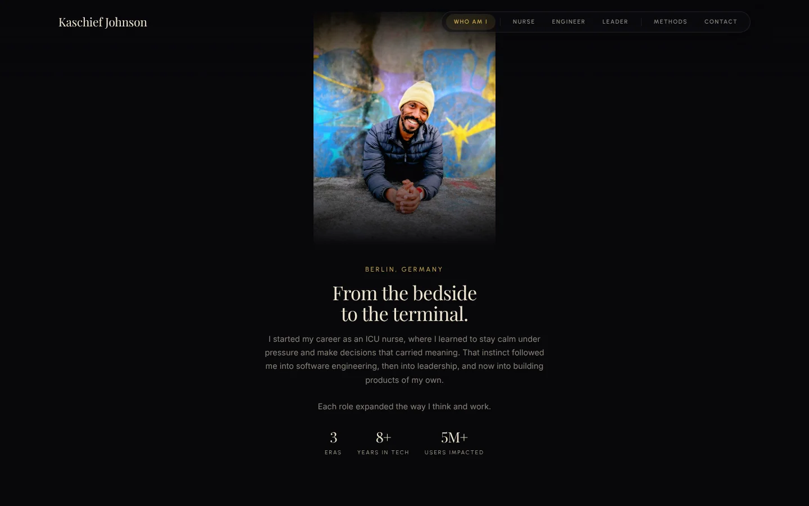
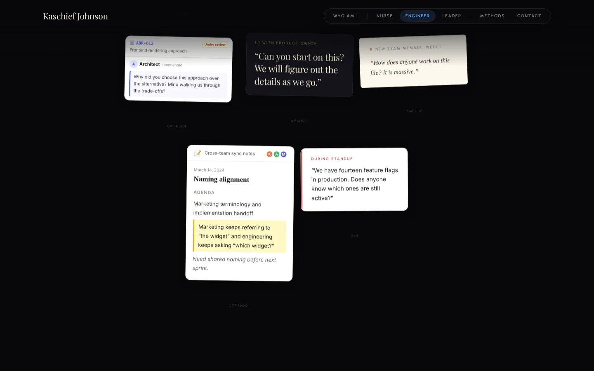

# kaschief.com

The source of my portfolio site, [kaschief.com](https://kaschief.com): a scroll-driven story of moving from ICU nursing into software engineering and leadership.


| | |
|---|---|
|  |  |

## Stack

Next.js 16 (App Router, server components first), React 19, TypeScript, Tailwind CSS 4, GSAP and Framer Motion for the scroll-linked animation. Deployed on Vercel.

## How it's organised

Each part of the page is a feature module under `features/` (hero, timeline, methods, contact and so on) with an explicit public API. Shared primitives live in `components/`, site content lives as typed data in `data/`, and `app/` holds only route entries. A script, `pnpm check:rules`, enforces those boundaries. [docs/ARCHITECTURE.md](docs/ARCHITECTURE.md) has the full layout.

## Testing

Vitest covers data, models and transformation logic. Playwright covers what a visitor actually does: navigation, the scroll journeys through each chapter, dialogs, keyboard use and mobile layouts. [docs/TESTING.md](docs/TESTING.md) explains the locator policy and page objects.

## Running it

```bash
pnpm install
pnpm dev          # http://localhost:3000
pnpm test         # unit tests
pnpm test:e2e     # browser tests
pnpm test:ci      # typecheck, architecture rules, lint, unit and browser tests
```
